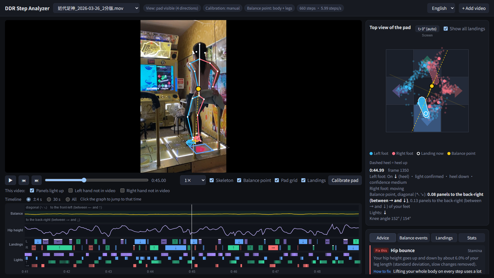
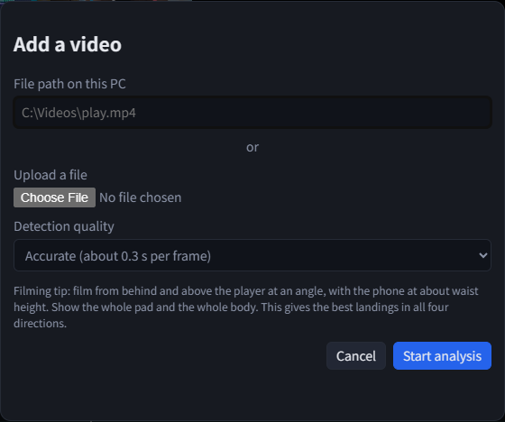
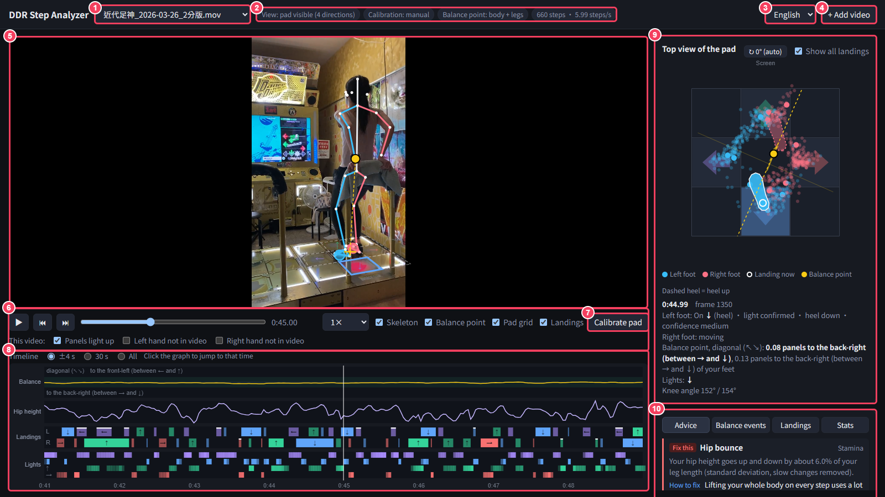
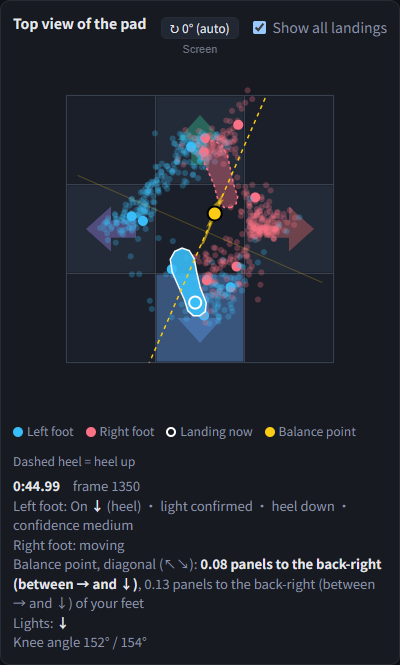
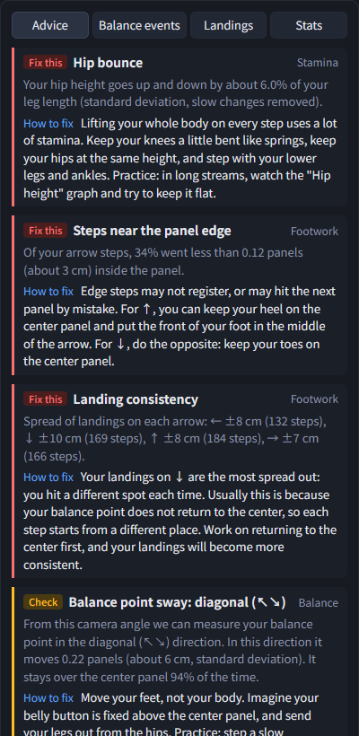
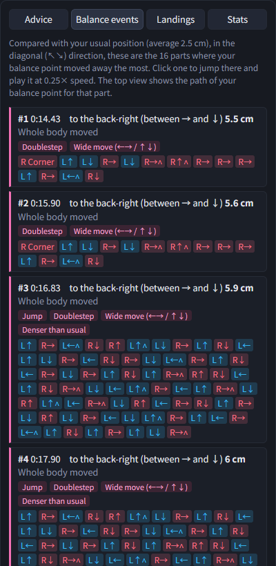
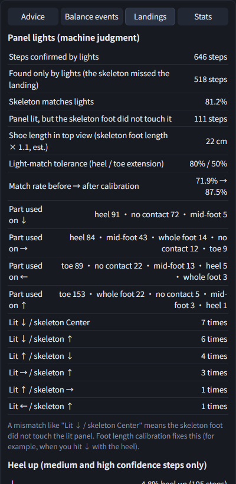
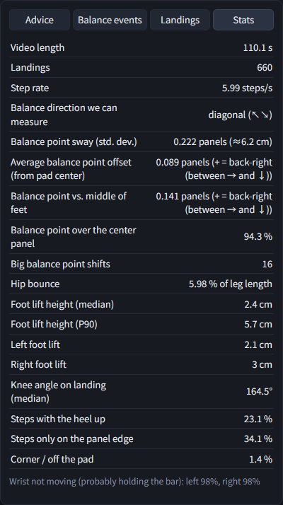
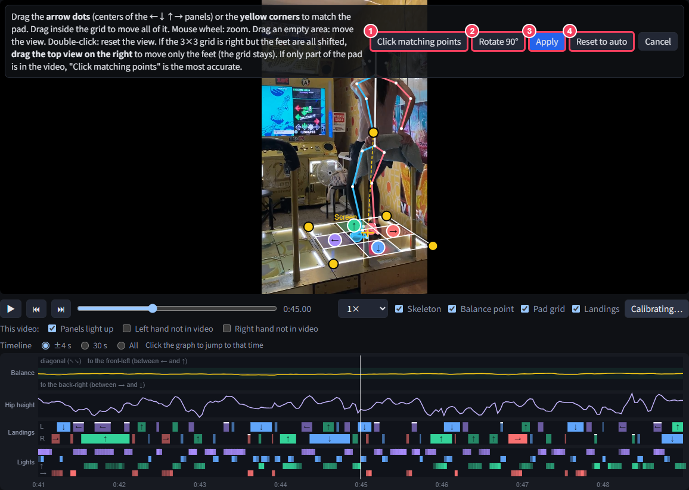
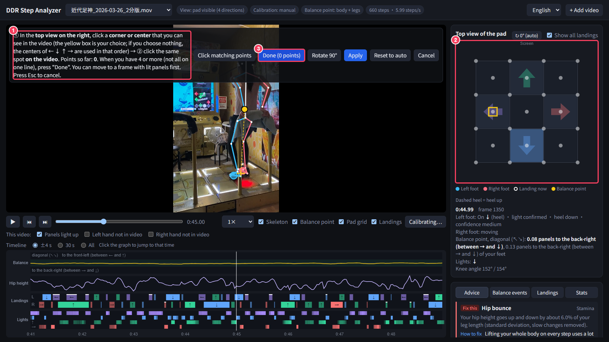

# DDR Step Analyzer

[日本語](README.md) ｜ [中文](README.zh-TW.md) ｜ **English**

DDR Step Analyzer looks at a video of you playing DDR and finds your skeleton (body joints).
It shows **where you really stepped**, **how your balance point moves**, and **how you use your heels and toes**,
and then gives you advice on how to improve.

- Everything runs on your own PC. Your videos and data are never sent anywhere.
- No AI subscription or paid service is needed (it uses only free, open-source software).
- You need the internet only for the first setup.



## Download and install (Windows)

### What you need

- Windows 10 or 11 (64-bit)
- 8 GB of memory or more, 3 GB of free disk space
- An internet connection for the first setup

### Steps (only the first time)

1. Open the **[download page (Releases)](https://github.com/xkamome/ddr-step-analyzer/releases/latest)**.
   Under "Assets", click the ZIP file with a name like **`ddr-step-analyzer_v1.6.zip`** (the number is the version) and save it.
   (You can also use the green "Code" button → "Download ZIP" at the top of this page. It has the same content.)
2. Right-click the ZIP file → "Extract All".
   Good place: `C:\ddr-step-analyzer`
   (Avoid the Desktop and OneDrive folders. Syncing can make the tool slow.)
3. In the extracted folder, double-click **`setup.bat`**.
   If a blue "Windows protected your PC" screen appears, click "More info" → "Run anyway".
4. A black window installs everything automatically (about 10–20 minutes).
   - If Python is not installed, it is installed for you (no administrator rights needed).
   - The skeleton detection models (about 360 MB) are downloaded.
5. When you see "Setup complete", press any key to close the window.
   A shortcut called **"DDR ステップ解析"** (DDR Step Analyzer) is now on your desktop.

## How to use

### 1. Start the app and add a video

1. Double-click "DDR ステップ解析" on the desktop.
   A black window (the analysis server) opens, and after a moment the app opens in your browser.
   Do not close the black window while a video is being analyzed.
2. The app uses the language of your browser (English, Japanese or Chinese). You can change it at the top right.
3. Click **"+ Add video"** at the top right.



- **File path on this PC**: paste the location of the video file (in File Explorer, Shift + right-click the file → "Copy as path").
- **Upload a file**: you can also choose the file here.
- **Detection quality**: usually "Accurate". A 2-minute video takes about 20–40 minutes.
  If you are in a hurry, use "Fast" (it takes a few minutes, but it may mix up the left and right feet when one foot is hidden).
- Click "Start analysis". The video list at the top shows the progress (% and time left).

### 2. The screen



| No. | Name | What it does |
|---|---|---|
| 1 | Video list | Switch between analyzed videos. Videos still being analyzed show their progress |
| 2 | Analysis status | View, pad calibration method (manual / auto), how the balance point is calculated, number of steps and steps per second. **Look here first to see if the analysis worked** (see "When the analysis does not work well" below) |
| 3 | Language | English / Japanese / Chinese (the advice changes too) |
| 4 | Add video | Analyze a new video |
| 5 | Video | Shows the skeleton (blue = left, red = right), the balance point (yellow dot), the 3×3 pad grid and the landings on top of the video |
| 6 | Playback | Play / step one frame (← → keys, Shift + ← → for 1 second), speed (0.25× for slow motion), layers on / off. The "This video:" row below has settings for each video (see "Panels that do not light up / hands not in the video" below) |
| 7 | Calibrate pad | Use this when the 3×3 grid does not match the real pad (explained below) |
| 8 | Timeline | From the top: "Balance", "Hip height", "Landings" (left and right foot; color and arrow = the panel you stepped on), "Lights" (4 rows for ←↓↑→). Click to jump to that time |
| 9 | Top view of the pad | The pad and your feet seen from above (explained below) |
| 10 | Result tabs | Advice / Balance events / Landings / Stats (explained below) |

### 3. Top view of the pad



- **Small dots**: your landings so far (blue = left foot, red = right foot). Turn them on / off with "Show all landings".
- **Shoe shapes**: where your feet are now. A white circle means "this foot is on the pad now".
  **If the back half of the shoe is dashed, your heel is up.**
- **Yellow dot and dashed line**: your balance point. One camera at an angle can measure the balance point in only one direction,
  so it means "your balance point is somewhere on the yellow dashed line".
- **Text below**: the current time, each foot (on which panel, toe / heel, light confirmed or not, confidence),
  how far your balance point is from the center, the lit panels, and your knee angles.
- **Direction**: the top view turns automatically to match the video. If you filmed from the front (the screen side), it turns 180° so that
  the camera side is at the bottom. The edge with the word "Screen" is the direction of the game screen.
  If the direction is wrong, click the **↻** button at the top right to turn it 90° at a time
  (saved in your browser for each video; turn it back to the automatic angle to return to "(auto)").

### 4. Result tabs

| Advice | Balance events | Landings | Stats |
|---|---|---|---|
|  |  |  |  |

- **Advice**: sorted as "Fix this", "Check", "Info" and "Good". Each item shows the numbers behind it and **how to fix it / how to practice**
  (thresholds are set for high-level players).
- **Balance events**: 10–20 moments where your balance point moved the most. **Click one to play it at 0.25× speed.**
  The top view then draws the path of your balance point and numbers your steps.
  The tags are the likely causes (jump, doublestep, wide move, denser than usual, and so on), and below them is the step order.
- **Landings**: panel lights (the machine's judgment) compared with the skeleton, which part of the foot you used on each panel
  (toe / heel / whole foot), and heel-up steps.
- **Stats**: a list of numbers such as video length, steps, balance point sway, hip bounce, foot lift height and knee angle.

**To quit**: just close the browser tab. The black window closes by itself after about 10 seconds.

## When the analysis does not work well

The status labels at the top (to the right of the video list), such as "Calibration: …" and "Balance point: …",
tell you how well the analysis worked.

### The 3×3 grid does not match the pad

Even with "Calibration: auto (panel lights)", the grid can be a little off the real pad.

1. Click **"Calibrate pad"** below the video.
2. Drag the **arrow dots** (centers of the ← ↓ ↑ → panels) or the **yellow corners** to match the real pad.
   - Drag inside the grid to move all of it.
   - Mouse wheel: zoom. Drag an empty area: move the view. Double-click: reset the view.
3. Click **"Apply"**. The video is analyzed again (about 1 minute; the skeleton is not detected again, so it is fast).



| No. | Button | When to use it |
|---|---|---|
| 1 | Click matching points | Only part of the pad is in the video, or dragging does not fit well (explained below) |
| 2 | Rotate 90° | The grid faces the wrong way (for example, ↑ and → are swapped) |
| 3 | Apply | Click when you are done. The video is analyzed again |
| 4 | Reset to auto | Stop using your manual calibration and go back to auto (panel lights) |

**If only part of the pad is in the video**, "Calibrate pad" → **"Click matching points"** is the most accurate.



1. Read the instructions (①). In the **top view on the right (②)**, click a **corner or center** of a panel that you can see in the video
   (the yellow box is your choice).
2. On the video, click **the same spot**.
3. Repeat for 4 or more points (not all on one straight line), then click **"Done" (③)** → "Apply".
   It is easier if you first move to a frame where the panels are lit. Press Esc to cancel.

### The grid is right, but the feet are all shifted

While calibrating, **drag the top view on the right** to move only the feet. The grid does not move
("Foot offset: right ○ cm, back ○ cm" is shown).

### Panels that do not light up / hands not in the video

Use the **"This video:"** row below the playback controls. Each video has its own settings.
When you change one, the video is analyzed again right away (the settings stay even if you calibrate again or click "Reset to auto").

| Setting | When to use it |
|---|---|
| Panels light up (**uncheck it**) | Machines whose panels do not light up when you step on them (for example, old white cabinets). Light from the speakers can reflect on the metal and look like panel lights, so the panels are judged wrong. When you uncheck it, an AI model (trained on videos from machines with panel lights) decides the panels from the skeleton (toe / heel become reference values, and heel-up is not shown). Videos where no panel lights can be found (for example, machines with white light frames) switch to this mode automatically |
| Left hand not in video / Right hand not in video | That hand is not in the video. The hand position guessed by the skeleton model is not used. The balance point uses a mirror of the other hand (or a relaxed, hanging arm) instead |

If only the wrist is in the video and the elbow is cut off at the edge, the app automatically uses the real wrist position and an estimated elbow.

### What the labels mean

| Label | Meaning | What to do |
|---|---|---|
| Calibration: auto (panel lights) | The pad was found from the panel lights (this is normal) | If it is off, use "Calibrate pad" above |
| Calibration: auto (footprint groups, reference only) | No panel lights were found, so the pad was guessed from your footprints. It is often off | Fix it by hand with "Calibrate pad" |
| Calibration: none / Too few landings to calibrate the pad | The app cannot find the pad | Use "Click matching points", or film again so the pad is visible |
| Balance point: from the hips (upper body off screen) | Your upper body is not in the video, so the balance point is guessed from your hips | Film so your upper body is in the video for better results |
| Right hand: ○% estimated (mirror of the other hand) | How often that hand was judged to be out of the video | If it is really not in the video, check "Right hand not in video" |
| No panel lights (an AI model guesses the panels from the skeleton) | "Panels light up" is unchecked | If the machine does light up, check it again |
| "Calibration: auto (panel lights)" but the grid looks wrong, or "Lights" shows lines when nothing is lit | The machine's panels do not light up, and light from the speakers is mistaken for panel lights | Uncheck "Panels light up" and fix the pad with "Calibrate pad" |
| confidence low | That step is uncertain, so it is not used in the stats | You can ignore it. If there are too many, try a different camera angle |

### The skeleton (feet) is off, or the left and right feet are swapped

- If you used "Fast", add the same video again with "+ Add video" and choose **"Accurate"** (it is added as a new item).
- When a foot is hidden by the bar or by the other foot, or the body is cut off at the edge of the video, the result will be less accurate.
- Videos filmed from the side at floor level, dark videos and shaky videos are better filmed again.

### The analysis shows "(error)"

- Add the video again with "+ Add video".
- If it still fails, please send a photo of the black window (the analysis server).
- To remove a result you do not need, delete the folder with the video's name inside the `data` folder in the install folder.

## Tips for filming

- Film from behind and above the player at an angle, with the phone at about waist height.
- Show the whole pad and the whole body (the upper body too, if you can).
- Keep the phone still (the camera position is checked every 2.5 seconds and corrected only when it moves a lot).
- It is OK to pick up the phone before or after playing (for example, to film the result screen).
  Parts without the pad and feet are left out of the analysis automatically.
- Videos filmed from the side at floor level cannot be analyzed, because the pad is not visible.

## Problems

| Problem | What to do |
|---|---|
| setup.bat stopped, or red text appeared | Check your internet connection and run setup.bat again. If it still fails, please send a photo of the screen |
| The browser does not open | Open http://127.0.0.1:8765 in your browser |
| "The server has stopped" appears | Double-click "DDR ステップ解析" on the desktop again |
| The analysis is very slow | Choose "Fast" for "Detection quality" when you add the video |

**Uninstall**: delete these:

- The extracted folder
- The desktop shortcut "DDR ステップ解析"
- The Python environment: `C:\Users\(your user name)\AppData\Local\ddr-pose`
- The models (about 360 MB): `C:\Users\(your user name)\.cache\rtmlib`

## Limits

- This is a 2D estimate from one camera. cm values are estimates, using about 28 cm per panel and about 38 cm for the lower leg.
- One camera at an angle can measure the balance point only along the horizontal direction of the video (the app shows which direction).
- Hands and the upper body outside the video are estimated. Frames where a foot is hidden by the bar or the other foot can be less accurate.
- The panel you stepped on and the number of steps come from the panel lights (taken as the correct answer).
  The skeleton decides which part of the foot (toe / heel) you used.
  For videos with "Panels light up" unchecked (machines without lights), an AI model guesses from the skeleton, so accuracy is lower
  (as a guide: it finds about 90% of the step timings, but it often picks the wrong panel or adds extra steps,
  so treat each single step as a reference only).

## Technical details

- **Pose**: YOLOX finds the player (every 10 frames) and RTMPose-x (Halpe26, with heel and toe points) finds 26 keypoints in every frame.
  Left / right labels are kept consistent over time with a Viterbi pass and checked against the pad geometry.
- **Camera motion**: the camera is treated as fixed. Every 2.5 seconds a keyframe is matched to the reference frame using background features;
  a new camera position is used only when it moves more than 3% of the width and the next keyframe agrees.
  Frames with no player, a camera that does not match, or feet far from the usual position (for example, filming the result screen) are not analyzed.
- **Pad calibration**: the arrow panels light up when stepped on. The lights over the whole video are added up on the reference frame,
  and the four bright areas give the four arrow centers. Fallback: footprint groups. Manual: "Calibrate pad".
- **Panel lights as the answer**: each step's panel comes from the lights. The skeleton decides heel / toe / whole foot.
  The lights are also used to fit the foot length and the height of the foot keypoints above the floor (3-stage analysis).
- **No lights**: when "Panels light up" is off, or fewer than 20 light onsets per minute are found, a learned model
  (`ddrpose/contact.py`, LightGBM trees exported to numpy, `ddrpose/models/contact_gbdt.npz`) finds the steps on the arrow panels
  from the skeleton. Tested on plays it had not seen: F1 0.19 (skeleton only) → 0.59.
- **Balance point**: Winter's segment mass model. The vertical direction uses the body axis (shoulder center → ankle center), not the video's vertical.
  Hidden arms are mirrored from the other arm or set to hang down.
- **Advice**: rule-based thresholds in `TH` in `ddrpose/analyze.py`. Advice text is written in Chinese, Japanese and English.

Command line:

```
start.bat                                                        # or: python server.py  (--no-browser, --no-auto-exit)
python -m ddrpose.pose "D:\...\IMG_1194.MOV" data\IMG_1194       # preview video + pose detection
python -m ddrpose.analyze data\IMG_1194                          # analysis (run this again after changing thresholds)
```

Data per video in `data/<video>/`: `preview.mp4` (for the browser), `pose.npz` (skeleton), `motion.npz` (camera motion),
`glow.npz` (panel lights), `calib.json` (manual calibration and per-video settings), `analysis.json` (results).

## License

[MIT License](LICENSE) © xkamome

You are free to use, change and share this software (including for commercial use),
but you must keep the copyright notice (author: xkamome) and the license text.
